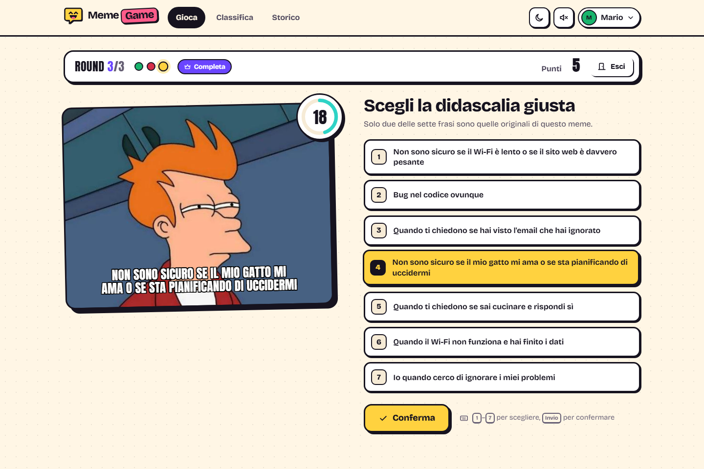
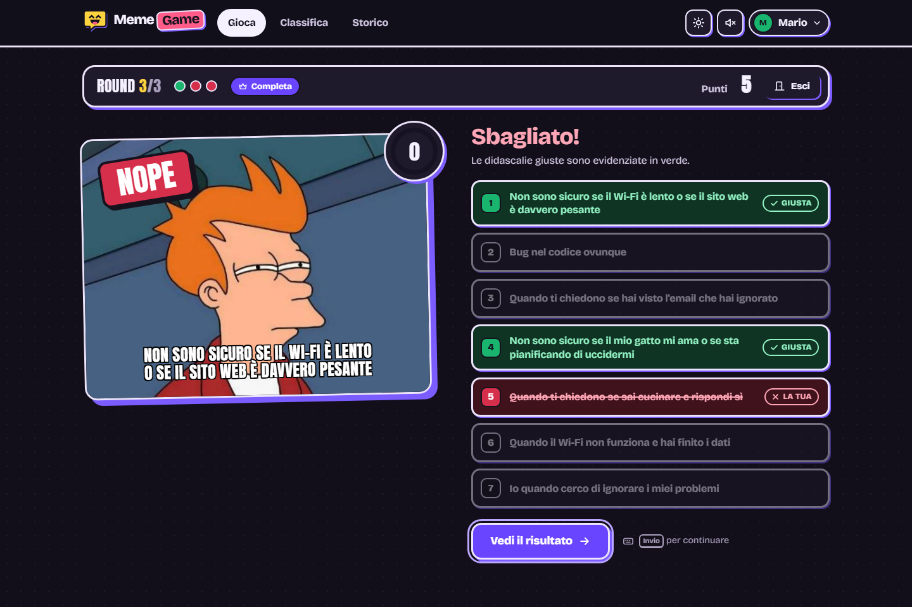
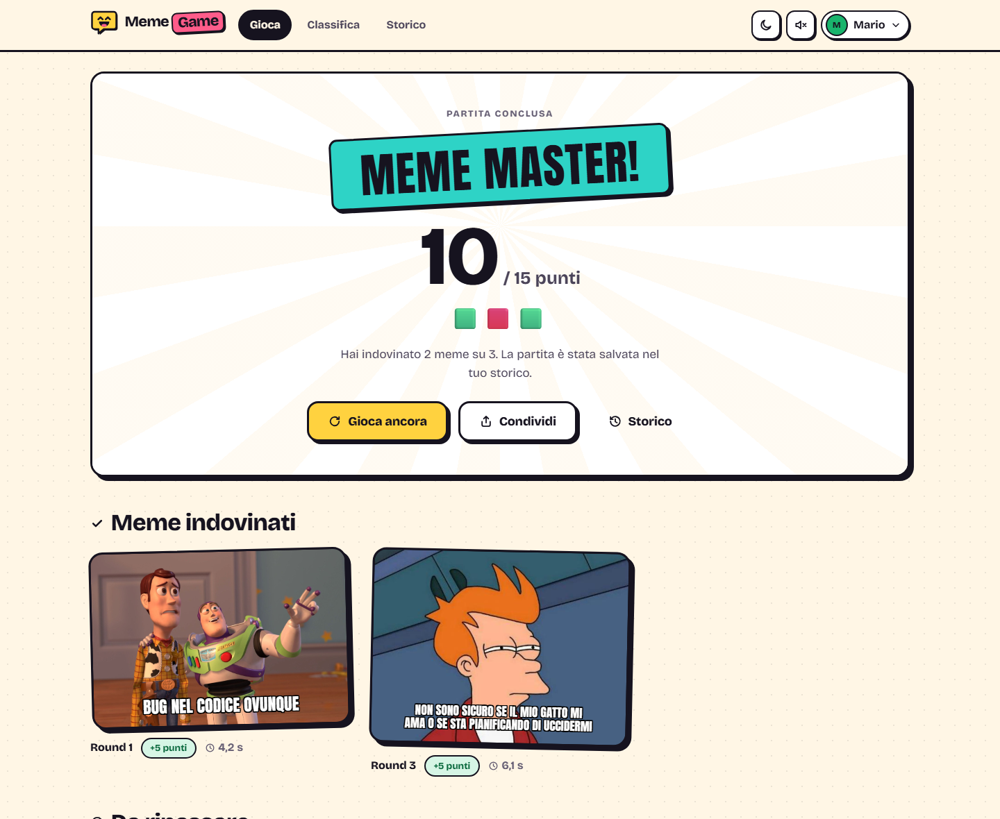
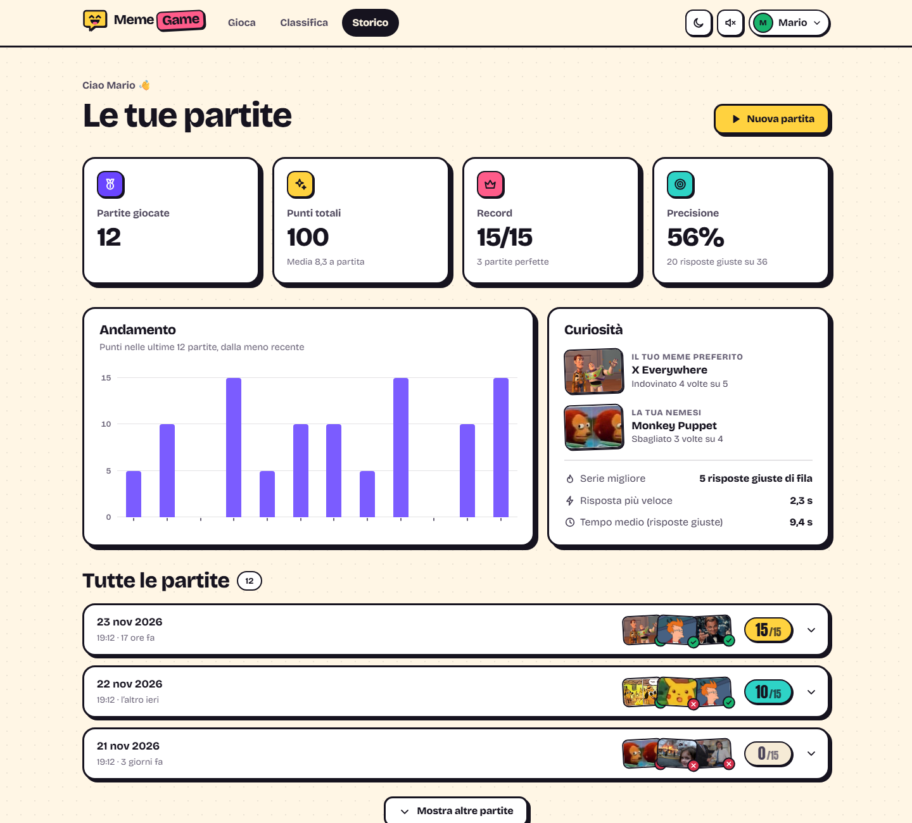
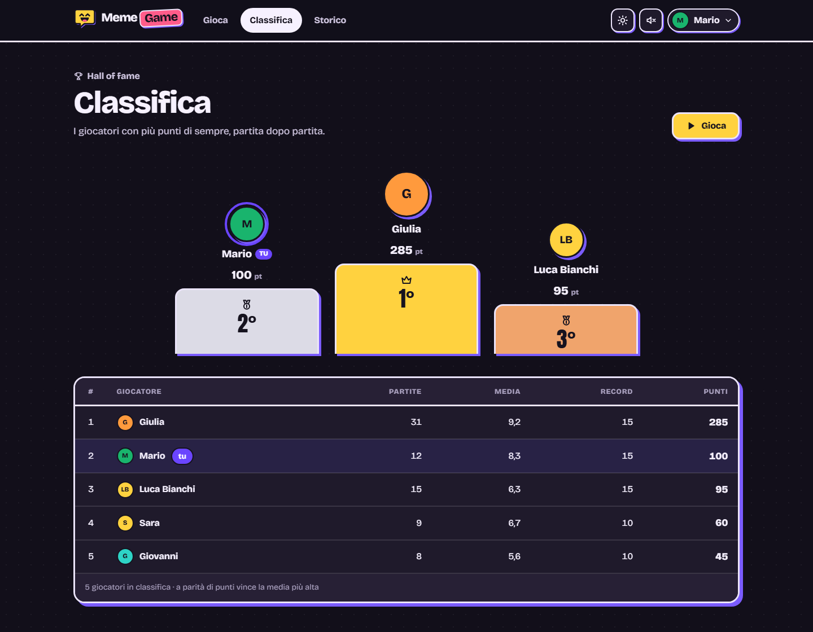
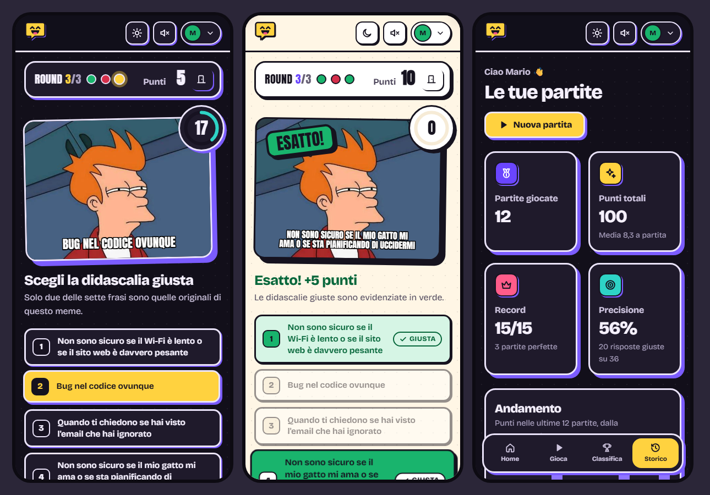
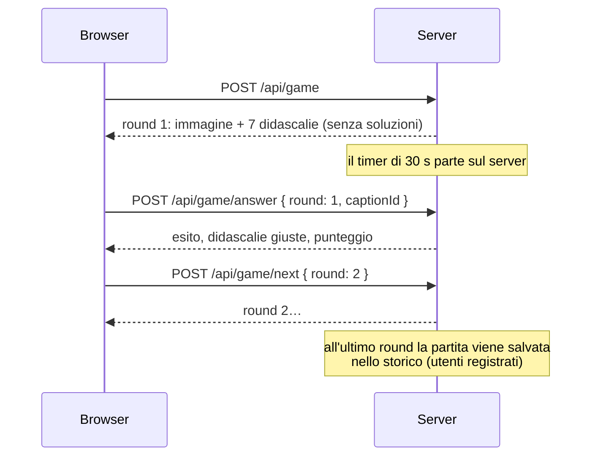

# 🎭 Meme Game

**Un meme, sette didascalie, trenta secondi. Solo due sono quelle giuste.**

Gioco web full-stack in cui si abbina la didascalia corretta a un meme prima che scada il tempo.
Partite veloci da ospite, partite complete con storico e statistiche per gli utenti registrati,
classifica globale, tema chiaro/scuro, effetti sonori e piena giocabilità da tastiera e da mobile.

[](https://github.com/nikcian/Meme-Game/actions/workflows/ci.yml)


## Indice

- [Funzionalità](#funzionalità)
- [Screenshot](#screenshot)
- [Avvio rapido](#avvio-rapido)
- [Come funziona una partita](#come-funziona-una-partita)
- [Architettura](#architettura)
- [API](#api)
- [Database](#database)
- [Sicurezza](#sicurezza)
- [Accessibilità](#accessibilità)
- [Test e qualità](#test-e-qualità)
- [Configurazione](#configurazione)
- [Novità rispetto alla versione d’esame](#novità-rispetto-alla-versione-desame)
- [Crediti](#crediti)

## Funzionalità

**Gioco**
- **Partita veloce** (ospite): un round, nessuna registrazione.
- **Partita completa** (registrati): tre round con meme sempre diversi, fino a 15 punti.
- Ogni round: 1 meme, 7 didascalie (2 giuste), **30 secondi**, +5 punti per risposta esatta.
- Anteprima in tempo reale: la didascalia scelta compare **sul meme**, in classico stile Impact.
- Rivelazione animata con le risposte giuste, timbro dell’esito e punteggio che “conta”.
- Riepilogo finale con verdetto, coriandoli, risultato condivisibile (🟩🟥🟩) e meme da ripassare.
- La partita sopravvive al refresh: il tempo residuo è calcolato dal server.

**Account e progressi**
- Registrazione con validazione e indicatore di robustezza della password.
- **Storico** paginato con dettaglio di ogni round, grafico dell’andamento e statistiche:
  precisione, record, partite perfette, serie migliore, risposta più veloce, meme preferito e “nemesi”.
- **Classifica** con podio, posizione personale e media punti.

**Esperienza**
- Tema chiaro e scuro (segue il sistema, scelta ricordata), transizioni tra pagine.
- Effetti sonori sintetizzati con Web Audio (nessun file da scaricare), disattivabili.
- Scorciatoie: tasti **1–7** per scegliere, **Invio** per confermare e proseguire.
- Layout responsive con tab bar su mobile; conferma prima di abbandonare una partita in corso.

## Screenshot

| Round in corso | Rivelazione |
| --- | --- |
|  |  |
| **Riepilogo** | **Storico e statistiche** |
|  |  |
| **Classifica** | **Mobile** |
|  |  |

<sub>Gli screenshot di storico e classifica usano dati di esempio.</sub>

## Avvio rapido

**Requisiti:** Node.js ≥ 22.22 (consigliato **26**, vedi `.nvmrc`). Nessun database da installare:
SQLite è integrato in Node (`node:sqlite`).

```bash
npm ci        # installa le dipendenze dal lockfile, senza eseguire script (vedi .npmrc)
npm run dev   # API su :3001 + client su :5173
```

Apri **http://localhost:5173**. Al primo avvio il database viene creato in `server/data/` con i
contenuti di gioco e due account demo:

| Username | Password |
| --- | --- |
| `user` | `testpass` |
| `prova` | `prova` |

### Produzione

In produzione un solo processo Express serve sia le API sia il client compilato.

```bash
cp server/.env.example server/.env   # imposta almeno SESSION_SECRET (≥ 32 caratteri casuali)
npm run build
npm start                            # http://localhost:3001
```

Per generare un segreto: `node -e "console.log(require('crypto').randomBytes(48).toString('base64url'))"`.
Dietro un reverse proxy HTTPS imposta anche `TRUST_PROXY=1` (cookie `Secure` e HSTS sono attivi di default in produzione).

### Script

| Comando | Cosa fa |
| --- | --- |
| `npm run dev` | Avvia server (con riavvio automatico) e client Vite insieme |
| `npm run build` | Compila il client in `client/dist` |
| `npm start` | Avvia il server in modalità produzione |
| `npm test` | Esegue i 41 test del server (`node:test`, nessuna dipendenza) |
| `npm run lint` | ESLint su tutto il progetto, incluse le regole del React Compiler |
| `npm run check` | Lint + test + build: quello che esegue anche la CI |
| `npm run security` | `npm audit` + verifica di firme e attestazioni dei pacchetti |
| `npm run db:reset` | Ricrea il database da zero (a server fermo) |

## Come funziona una partita

Il **server è l’unica fonte di verità**: sceglie immagini e didascalie, misura il tempo, valuta le
risposte e calcola i punti. Il client non riceve mai le soluzioni prima di aver risposto e non può
inviare punteggi.



Dettagli che rendono il motore robusto:
- le operazioni sono **sincrone e atomiche** (SQLite sincrono, nessun `await` tra lettura e scrittura):
  due risposte inviate in parallelo non possono essere accettate entrambe;
- una risposta oltre i 30 secondi (più 2 s di tolleranza di rete) vale come **tempo scaduto**;
- `next` è **idempotente**: un doppio click non salta un round;
- le partite in corso vivono in memoria con scadenza e un tetto massimo, quelle concluse finiscono
  nel database in **un’unica transazione**.

## Architettura

```
.
├── client/                  React 19 + React Router 8 + Vite 8 (CSS scritto a mano, nessun framework UI)
│   ├── public/              favicon, manifest, script del tema (anti-flash)
│   └── src/
│       ├── components/      layout, gioco (timer, round, riepilogo), MemeCard, grafico, dialog…
│       ├── context/         autenticazione, preferenze (tema/suoni), notifiche
│       ├── lib/             client API, formattazione it-IT, suoni Web Audio
│       ├── pages/           Home, Gioca, Storico, Classifica, Accedi, Registrati, 404
│       └── styles/          design token, base, componenti
├── server/                  Express 5 + express-session + Helmet, SQLite con node:sqlite
│   ├── public/              immagini dei meme
│   ├── src/
│   │   ├── db/              migrazioni versionate, contenuti, seed, transazioni
│   │   ├── lib/             password (scrypt), rate limiter, session store SQLite, validazione
│   │   ├── middleware/      header di sicurezza, CSRF, autenticazione, errori
│   │   ├── repositories/    accesso ai dati (query preparate)
│   │   ├── routes/          sessione, partita, storico e classifica
│   │   └── services/        motore di gioco
│   ├── test/                41 test di integrazione e unità
│   └── requests.http        richieste di esempio per provare le API a mano
├── scripts/dev.mjs          avvio congiunto di server e client
└── .github/                 CI (Node 22/24/26) e Dependabot
```

Le dipendenze sono ridotte all’essenziale: **3 dirette lato server** (`express`, `express-session`,
`helmet`) e **5 lato client** (`react`, `react-dom`, `react-router` e due font self-hosted).

## API

Tutte le risposte sono JSON. Gli errori hanno la forma `{ "error": "messaggio", "details"?: { campo: "messaggio" } }`.

| Metodo e percorso | Accesso | Descrizione |
| --- | --- | --- |
| `GET /api/health` | pubblico | Stato del servizio |
| `GET /api/session` | pubblico | Utente corrente (`{ user: null }` se non autenticato) |
| `POST /api/session` | pubblico | Login `{ username, password }` (limitato contro il brute force) |
| `DELETE /api/session` | pubblico | Logout |
| `POST /api/users` | pubblico | Registrazione `{ username, name, password }`, effettua anche il login |
| `POST /api/game` | pubblico | Nuova partita: 3 round se autenticato, 1 altrimenti |
| `GET /api/game` | stessa sessione | Partita in corso (`{ game: null }` se nessuna) |
| `POST /api/game/answer` | stessa sessione | Risposta `{ round, captionId }` (`null` = tempo scaduto) |
| `POST /api/game/next` | stessa sessione | Distribuisce il round `{ round }` successivo |
| `DELETE /api/game` | stessa sessione | Abbandona la partita |
| `GET /api/history?limit&offset` | autenticato | Storico paginato con i round di ogni partita |
| `GET /api/history/stats` | autenticato | Statistiche personali |
| `GET /api/history/:id` | proprietario | Dettaglio di una partita (404 se non è tua) |
| `GET /api/leaderboard` | pubblico | Classifica (solo nomi visualizzati: niente username né id) |

Esempi pronti all’uso in [`server/requests.http`](server/requests.http).

## Database

SQLite in `server/data/meme-game.db` (ignorato da git), creato e aggiornato da **migrazioni versionate**
(`PRAGMA user_version`); WAL e foreign key attivi.

| Tabella | Contenuto |
| --- | --- |
| `users` | username univoco (case-insensitive), nome visualizzato, hash scrypt autodescrittivo |
| `images` | file, titolo, testo alternativo, dimensioni (niente spostamenti di layout) |
| `captions` | didascalie |
| `memes` | coppie immagine–didascalia corrette |
| `games` | partite concluse: utente, data (ISO 8601), punteggio |
| `rounds` | round di ogni partita: immagine, didascalia scelta, esito, timeout, tempo di risposta |
| `sessions` | sessioni di express-session, con scadenza e pulizia periodica |

I contenuti di gioco e le partite di prova del progetto originale sono in `server/src/db/content.mjs`.

## Sicurezza

### Audit iniziale

Prima di scaricare qualunque pacchetto sono stati analizzati i lockfile esistenti:
**45 vulnerabilità note** (server: 2 critiche, 13 alte; client: 14 alte), soprattutto nella catena
nativa di `sqlite3` (`tar`, `tar-fs`), in Express 4.19, in `express-validator` e nel vecchio tooling.
Oggi: **0 vulnerabilità**, con ~220 pacchetti installati contro ~550.

### Bug di sicurezza corretti

| Problema nella versione precedente | Correzione |
| --- | --- |
| `GET /api/images/<id inesistente>/captions` mandava il server in **ciclo infinito**: chiunque, senza login, poteva bloccarlo con una richiesta | Endpoint rimosso; input validati; motore di gioco riscritto |
| `POST /api/history` con meno di 3 round lanciava un’eccezione non gestita: **crash del processo** | Nessun salvataggio inviato dal client; salvataggio transazionale lato server |
| Il client calcolava il punteggio e lo inviava: bastava una richiesta per registrare **15 punti a ogni partita** | Partite autoritative lato server |
| `POST /api/images/:id/captions` rivelava le risposte giuste **prima** di rispondere | Soluzioni inviate solo dopo la risposta |
| `GET /api/history/:id` mostrava le partite di **qualsiasi utente** (IDOR) | Controllo di proprietà, 404 per le partite altrui |
| Segreto di sessione scritto nel codice, nessun limite ai tentativi di login | Segreto da ambiente (obbligatorio in produzione), rate limiting |
| Tempi di risposta diversi per utenti esistenti e inesistenti (enumerazione degli username) | Verifica fittizia a tempo costante |

### Misure attive

- **Password:** scrypt con parametri OWASP (N=2¹⁴, r=8, p=5), salt casuale, confronto a tempo costante,
  aggiornamento automatico degli hash al cambio di parametri.
- **Sessioni:** id rigenerato al login (niente *session fixation*), cookie `HttpOnly`, `SameSite=Strict`,
  `Secure` + prefisso `__Host-` in produzione, store persistente su SQLite.
- **CSRF:** oltre a `SameSite=Strict`, le richieste che modificano dati devono arrivare dallo stesso
  origin (header Fetch Metadata e `Origin`). Nessun CORS: client e API condividono l’origin.
- **Header:** Content-Security-Policy restrittiva (niente script o stili inline), `X-Frame-Options: DENY`,
  `Referrer-Policy`, `Permissions-Policy`, HSTS in HTTPS (Helmet).
- **Abusi:** rate limiting su login (per IP e per coppia IP-account), registrazione, creazione di partite e API in generale;
  body JSON limitati a 10 KB; validazione di ogni input; errori senza dettagli interni.
- **Privacy:** font self-hosted (nessuna richiesta a CDN di terze parti), classifica con soli nomi visualizzati.

### Supply chain

Il 2026 ha visto diversi worm su npm (TanStack a maggio, “ChainDrop” ad agosto), che si propagano
tramite gli script di installazione. Per questo:

- **`.npmrc` di progetto:** `ignore-scripts=true` (nessuno script di installazione delle dipendenze),
  `min-release-age=7` (si installano solo versioni pubblicate da almeno 7 giorni), `allow-git=none`,
  `save-exact=true`, `engine-strict=true`;
- ogni installazione è stata verificata con `npm audit` e `npm audit signatures` (firme del registry e
  attestazioni di provenienza) ed è stato controllato che nessuna versione compromessa nota fosse nel lockfile;
- **CI** con privilegi minimi e Actions fissate al commit SHA; **Dependabot** con cooldown di 7 giorni.

Per segnalare una vulnerabilità vedi [SECURITY.md](SECURITY.md).

## Accessibilità

- Didascalie come radio nativi in un `fieldset`: frecce, Tab e lettori di schermo funzionano senza codice extra.
- Annunci `aria-live` per inizio round, 10 e 5 secondi rimasti ed esito; focus gestito tra le fasi.
- Esito mai affidato al solo colore (icone ed etichette “Giusta” / “La tua”); contrasto verificato.
- `prefers-reduced-motion` rispettato ovunque (animazioni, coriandoli, contatori); grafico con tabella equivalente.
- Link “Vai al contenuto”, focus visibile, testi alternativi in italiano per ogni meme.

## Test e qualità

`npm test` esegue **41 test** con il test runner integrato di Node, su un database in memoria e un
orologio controllabile (i timeout si testano senza attese reali). Coprono, tra l’altro:

- header di sicurezza, CSRF, cookie, path traversal, JSON malformati e body troppo grandi;
- login, logout, session fixation, brute force, registrazione e duplicati;
- composizione dei round, soluzioni mai esposte in anticipo, risposte doppie e concorrenti, timeout, refresh;
- storico paginato, statistiche, IDOR, classifica, atomicità dei salvataggi e persistenza delle sessioni.

ESLint 10 (flat config) include le regole del **React Compiler** (`eslint-plugin-react-hooks` v7):
il progetto passa con zero errori e zero warning.

## Configurazione

Tutte le variabili sono documentate in [`server/.env.example`](server/.env.example). Le principali:

| Variabile | Default | Note |
| --- | --- | --- |
| `SESSION_SECRET` | generato in sviluppo | **Obbligatoria in produzione** (≥ 32 caratteri) |
| `PORT` / `HOST` | `3001` / `localhost` | In produzione `HOST` è `0.0.0.0` |
| `SECURE_COOKIES` | `true` in produzione | Cookie `Secure` e HSTS |
| `TRUST_PROXY` | `false` | Numero di proxy fidati (per IP e HTTPS corretti) |
| `SEED_DEMO_DATA` | `true` | Account e partite demo al primo avvio |
| `DATA_DIR` / `DB_FILE` | `data` / `meme-game.db` | Posizione del database |

## Novità rispetto alla versione d’esame

- Architettura **client-server autoritativa** al posto del punteggio calcolato dal client.
- **Registrazione**, **classifica**, **statistiche** con grafico, partite che sopravvivono al refresh.
- Interfaccia completamente ridisegnata, senza Bootstrap: design system proprio, tema scuro, mobile, suoni.
- Logo originale al posto del logo “What Do You Meme?®”, marchio registrato di un gioco commerciale.
- Stack aggiornato: React 19, React Router 8, Vite 8, Express 5, ESLint 10; `node:sqlite` al posto di `sqlite3`.
- Database riproducibile (migrazioni + seed) invece di un file binario nel repository.
- Test automatici, CI, hardening della supply chain e della sicurezza applicativa.

## Crediti

Nato come progetto d’esame (*Exam #1: «Gioco dei Meme»*) di Nicola Ciancia (s322359).

- Le immagini dei meme appartengono ai rispettivi autori e sono usate a scopo ludico e didattico.
- Font: [Bricolage Grotesque](https://fonts.google.com/specimen/Bricolage+Grotesque) e
  [Anton](https://fonts.google.com/specimen/Anton), entrambi con licenza SIL Open Font License,
  distribuiti tramite [Fontsource](https://fontsource.org).
